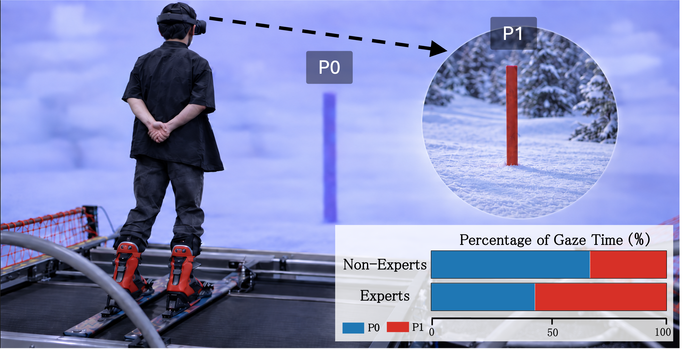
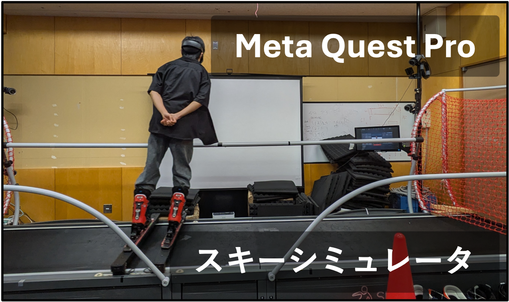
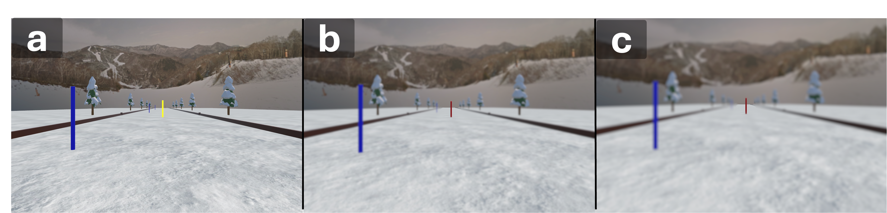
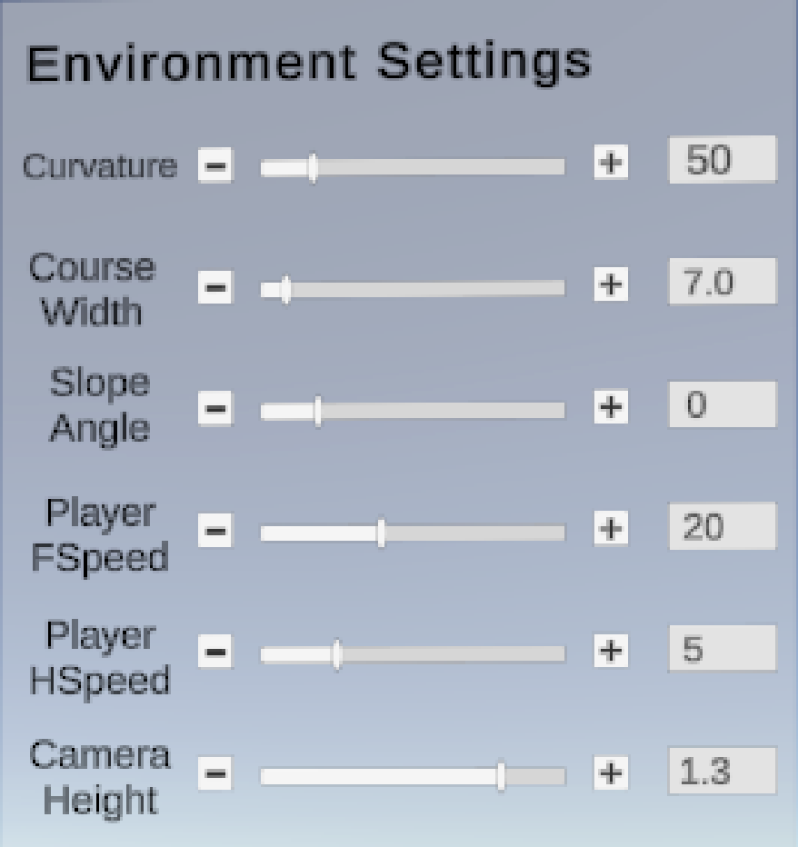
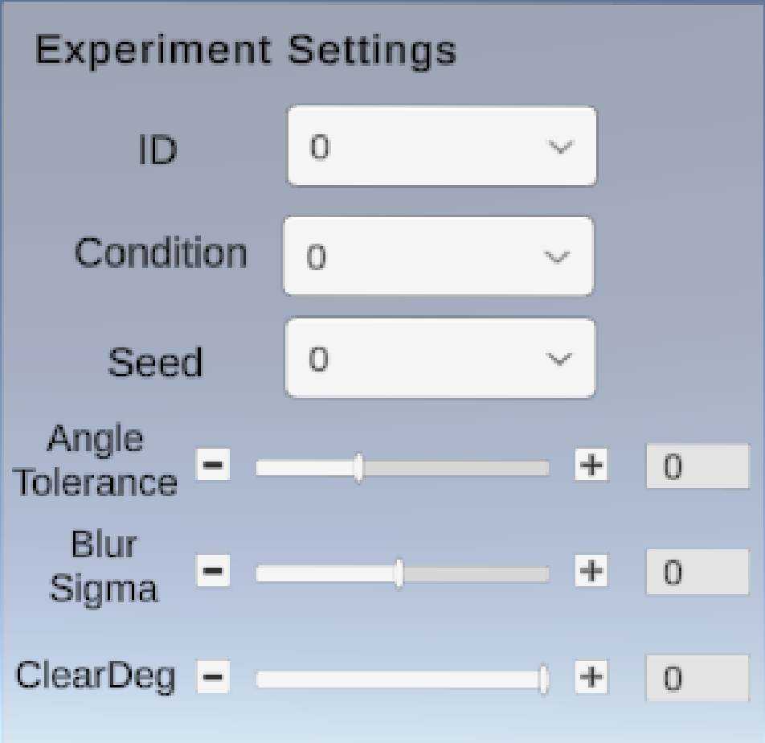

# 視線誘導を用いたVRアルペンスキートレーニングシステム



*システムのソースコードは非公開

## Publications / Presentations

- Eiichi Kihara et al., “Dynamic Blur Guidance for Look-Ahead Gaze in VR Ski Training,” ACM Symposium on Virtual Reality Software and Technology (VRST 2026), Paper, 登壇発表予定.

- 木原 英一ら，「視線誘導を用いたVRアルペンスキートレーニングシステム」，第33回インタラクティブシステムとソフトウェアに関するワークショップ（WISS 2025），デモ発表．

## 目的

本システムは，**視線誘導を用いたアルペンスキーの技能獲得支援に関する研究**における提案手法のシステムである．

アルペンスキーでは，高速に滑走しながら次の旗門を早期に捉え，滑走ラインやターンを事前に計画する必要があるため，**いつ，どこを見るかという視線の使い方**が重要となる．既存研究では，熟練者は早い段階から2つ先の旗門を見る傾向がある一方，非熟練者はこれから通過する旗門や手前の雪面を見る傾向があることが示されている．

そこで本システムでは，**2つ先の旗門へ視線を誘導することで，熟練者に見られる視線の使い方の習得を支援する**．視線誘導には Gaussian Blurを用い，視線誘導対象の旗門の周辺をクリアに保ちながら，それ以外の領域をぼかすことで暗黙的に視線を誘導する．

### なぜ VRを用いるのか

実環境では，口頭指導だけで，いつ，どこを見るべきかを滑走中に伝えることは難しく，また，滑走中に適切なタイミングで旗門をハイライト表示するなどの操作をするのも容易ではない．VRでは視覚情報をリアルタイムに制御でき，滑走状況に応じて見るべき対象へ動的に視線誘導できるため．

### なぜ Gaussian Blurを用いるのか

予備実験では，見るべき旗門をハイライト表示 (下記画像(a))し明示的に誘導したが，表示が煩わしく，特定の場所を見るよう強制されている感覚を与えてしまうという課題があった．

一方，Gaussian Blurを用いた暗黙的な視線誘導は，静止画などの分野で利用され，その有効性が示されている．しかし，それがスキーのような高速で周りの環境が変化し，自身も激しく動作するような場面において，その有効性は明らかになっていないため．

## システム構成



本システムは，スタンドアロン型の VR ヘッドマウントディスプレイ(Meta Quest Pro)と，室内用スキーシミュレータの2つの主要なハードウェアによって構成される．

Meta Quest Pro は，VR空間の描画やアイトラッキング，視線誘導の提示といった主要な処理を実行している．

スキーシミュレータは，横方向の加重移動によるスキーの滑走感を再現している．SkyTechSport 社製の President Lux Model を使用している．


## ガウシアンブラー (Gaussian Blur)




### 概要

自分がこれから通過しようとしている旗門を `P0`，その次の旗門 `P1`を視線誘導対象として扱う．`P1`周辺を鮮明に保ち，それ以外の領域をガウシアンブラーでぼかすことで，暗黙的に `P1`へ視線を誘導する.

実験では，異なるブラー強度である **Weak（σ = 0.8, 画像b）** と **Strong（σ = 1.3, 画像c）** を比較した．（**画像a** は ブラーなし．黄色く点灯している旗門が `P1`に当たる）カーネル半径は $R = ceil (3\sigma)$ とした．

### 実装

Gaussian Blurは，2次元Gaussian重みを縦方向と横方向に分離できる性質を利用して実装している．
2次元Gaussian重みは次式で定義される．

```math
G(x,y)
=
\frac{1}{2\pi\sigma^2}
\exp\left(
-\frac{x^2+y^2}{2\sigma^2}
\right)
```

指数関数を分解すると，

```math
G(x,y)
=
\left(
\frac{1}{\sqrt{2\pi}\sigma}
\exp\left(-\frac{x^2}{2\sigma^2}\right)
\right)
\left(
\frac{1}{\sqrt{2\pi}\sigma}
\exp\left(-\frac{y^2}{2\sigma^2}\right)
\right)
```

となるため，

```math
G(x,y)=G_x(x)G_y(y)
```

として，横方向と縦方向の2回の1次元Gaussian重みに分離できる．
よって 1pixelあたりの計算量を，カーネル幅を $K$ として，
$O(K^2)$ から $O(K)$ に落とすことができる．

Unity上ではURPのRenderer FeatureとShaderを用いて，
元画像に横方向と縦方向の Gaussian Blurを順に適用した．
最後に，`P1` 周辺では元画像を表示し，
それ以外ではGaussian Blur適用後の画像を表示した，

## 実装上の工夫点

### 工夫点1：GPU負荷の軽減

Gaussian BlurはMeta Quest Pro実機ではGPU負荷が大きく，フレームレートが大幅に低下した．VRではフレームレートの低下がユーザー体験の悪化に直結するため，Gaussian Blur処理の高速化と，URPの描画設定の最適化に取り組んだ．

複数回の計測結果の平均値を比較したところ，最適化によって以下の改善が得られた．

| 指標 | 最適化前 | 最適化後 |
| --- | --- | --- |
| GPU Time | 29.66 ms | 14.32 ms |
| FPS | 30 | 60 |

GPU Timeは，GPUが1フレームを描画するために要した時間であり，値が小さいほどGPU負荷が低い．

最適化には以下の手法を用いた．各手法の改善寄与率を全体の改善具合を100%として示す．

| 手法 | 内容 | 改善寄与率 |
| --- | --- | --- |
| MSAAのサンプル数の削減 | MSAAのサンプル数を4xから2xへ削減し，描画負荷を抑えた． | 56.8% |
| Rendering Pathの簡素化 | URPのRendering PathをForward+からForwardへ変更した． | 14.0% |
| Down Sampling | Blur処理時のみ画像の縦横を1/2に縮小し，処理するピクセル数を1/4に削減した． | 21.9% |
| Bilinear Sampling | 隣接する2つのサンプルをBilinear補間によって1回にまとめ，テクスチャのサンプリング回数を削減した． | 5.6% |
| Gaussian重みの前計算 | Gaussian重みをCPUで前計算し，Shaderへ渡すことでGPUでの重複計算を削減した． | 1.7% |

### 工夫点 2

特定のオブジェクトを見ているかどうかの判定を安定してできるように工夫した．当初は，Unityの`Physics.Raycast`を用いて，視線RayがColliderと衝突した位置を取得していた．

```csharp
if (Physics.Raycast(gazeOrigin, gazeDirection, out hit))
{
    gazePosition = hit.potision;
}
```

しかし，この方法では判定結果がColliderの形状に依存し，意図しないObjectとの衝突などによって結果が変化する．また，被験者全員のキャリブレーション後に許容角度を決め，視線に関する指標を再計算する際にも，Raycastを介した判定は冗長であった．
そこで，滑走者自身から旗門に対するベクトルと視線ベクトルとの角度差が許容範囲に入っているかどうかで判定するようにした，より単純であるが安定する判定方法となった．

視線のベクトルを $\mathbf{d}$，
その基点の位置を $\mathbf{o}$，旗門の位置を $\mathbf{p}$ とすると，旗門への方向ベクトルは，

```math
\mathbf{v}
=
\frac{\mathbf{p}-\mathbf{o}}
{\|\mathbf{p}-\mathbf{o}\|}
```

となり，このベクトルと視線ベクトルがなす角を

```math
\theta
=
\cos^{-1}(\mathbf{d}\cdot\mathbf{v})
```

として，これが設定した許容角度以内であれば，その旗門を見ていると判定する．

雪面については，視線ベクトルの方程式

```math
\mathbf{x}(t)=\mathbf{o}+t\mathbf{d}
```

と雪面の方程式

```math
\mathbf{n}\cdot(\mathbf{x}-\mathbf{p}_s)=0
```

を用いて，両者の交点

```math
t=
\frac{\mathbf{n}\cdot(\mathbf{p}_s-\mathbf{o})}
{\mathbf{n}\cdot\mathbf{d}}
```

```math
\mathbf{x}_{hit}
=
\mathbf{o}+t\mathbf{d}
```

を計算する．この交点の位置から雪面上のどの位置を見ているかを判定する．

## Scene 構成

設定，動作確認，計測，補正を行うための4つのSceneで構成される．

### Settings

下記の画像で示す環境パラメータおよび実験パラメータを設定するためのScene．設定した値は，他のSceneのコース生成や実験条件にリアルタイムに反映される．

### Recording

実験データを記録するためのScene．滑走中のデータをCSVファイルとして保存する．

主に以下の情報を記録する．

- 計測時刻
- 視線の起点および視線方向ベクトル
- 現在の旗門（`P0`）および次の旗門（`P1`）の位置
- 環境・実験パラメータ

### Test

計測は行わず，視線取得や視線誘導の動作を確認するためのScene. 取得した視線をVR空間上に可視化し，視線が意図した方向に正しく表示されているかを確認できる．

### Calibration

視線計測に生じる誤差を記録するためのScene．視野内の複数の位置に旗門を順に表示し，滑走者はこの旗門を注視してもらう．それによって，旗門の位置と取得した視線から視線の計測誤差を記録する．
記録したデータは，Recordingにて計測したデータを後から補正するために利用する．

## ファイル構成

```text
Assets/
├── Scenes/                    # 設定、実験環境、CalibrationのScene
├── Scripts/
│   ├── Common/                # Scene間で共有する小規模な計算処理
│   ├── Environment/           # 滑走コースの生成処理
│   ├── Method/                # 各視線誘導手法の実装
│   ├── Player/                # 移動や旗門の通過判定などの処理
│   ├── Recording/             # 視線や旗門の通過率などのデータを記録する処理
│   └── UI/                    # ボタンやスライダーなどのUI要素の実装
├── Resources/RandomSeeds/     # コース生成時に読み込むシード値
├── Editor/                    # seed生成などUnity Editor専用処理
├── MyAssets/                  # プロジェクト固有のmaterial・shader・audio
└── Tests/                     # EditMode Tests, PlayMode Tests
Packages/                      # Unity packageの依存関係
ProjectSettings/               # Unity Editor・build・rendering設定
scripts/                       # ローカルとCIで共通のUnity検証入口
.github/workflows/             # GitHub ActionsのUnity validation
```

## パラメータ調整 UI

システムの設計や実験で滑走してもらうコースを整備する際には，
自分の進行速度やコースの横幅など，各環境パラメータの値が適切かどうかを繰り返し調整する必要がある．そのため，各パラメータをシステム上から簡単に調整できるようにした．

<table>
<tr>
<td width="50%"></td>
<td width="50%"></td>
</tr>
</table>

| 環境パラメータ | 内容 | 実験パラメータ | 内容 |
| --- | --- | --- | --- |
| Curvature | コースの曲がり具合 | Subject ID | 被験者を識別するID |
| Course Width | コースの横幅 | Condition | 適用する視線誘導の条件 |
| Slope Angle | コース斜面の傾斜角度 | Seed | 使用するコース生成用の乱数Seed値 |
| Player FSpeed | 滑走者の進行方向の速度 | Angle Tolerance | 旗門を見ていると判定する際に許容する角度 |
| Player HSpeed | 滑走者の左右方向への移動速度 |  |  |
| Camera Height | 滑走者の視点の高さ |  |  |
